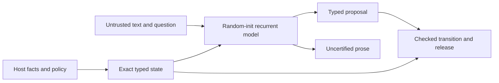

# Structured language pretraining

Can an exact semantic workspace help a recurrent language model learn useful,
supported reasoning from random initialization, beyond an equally informed
external workspace using the same checker? This repository contains the small
language prototype, executable support interfaces, bounded proofs and negative
pilot evidence needed to investigate that question. It does not establish an
architecture advantage or general alignment.

Every learned model in the active recipe starts from random weights. There is
no inherited backbone, adaptation checkpoint or post-training strategy. Initial
joint supervision of byte prediction and typed claims is part of pretraining.

| Component | Implemented | Tested / proved | Still proposed |
| --- | --- | --- | --- |
| Byte language model | Selective SSM/GRU, shared evidence projection, internal/output-only/none routing | Small CPU forward/backward checks; local development training receipts | Useful broad language and robust held-out reasoning |
| RMS stability variant | Parameter-free normalization before FFNs and both heads | CPU checks and audited one-seed 1,000-update local stability screen | Architecture benefit and broader usefulness unestablished |
| Exact RECORD kernel | Host facts, finite declared rules, checked derivations, revocation, policy-aware deterministic release | Bounded adversarial CPU tests and AI-assisted independent source review | Mechanized proof and trained integration with the language model |
| Same-information interfaces | Detached structured view and canonical JSON view; shared checked operations and feedback | CPU roundtrip/adversarial tests | A trained strong external-workspace baseline, encoding/cost matching |
| Three-bit workflow reference | Python memory checker, Lean specifications and persistent Lean adapter | Lean induction results for its declared workflow semantics; bounded historical differential evidence | Python-to-Lean refinement, transport authentication and RECORD proof |

The RECORD interface and the language model's existing finite evidence lane
are separate implementations. This release does not claim that the new RECORD
state is already integrated into the trained recurrent model. The workflow
Lean theorems cover a different state machine and do not transfer to either
Python model or RECORD code.



The new RECORD state and the trained model's existing evidence lane remain
separate; this diagram shows the intended trust contract, not completed RECORD
integration. [Architecture details](docs/architecture.md) distinguish them.

## Run the CPU evidence

With Python 3.12 and the dependencies installed:

```sh
python -m pip install -r environment/requirements-cpu.txt
python tools/check_cpu.py
```

The second command runs the deterministic interface demo, a tiny random-init
language forward pass and selected non-optimizing CPU tests. It downloads no
corpus, launches no training, accesses no GPU and requires no Lean installation.
An optional actual-Lean smoke test skips when Lean is unavailable. Installation
requires package downloads. Exact tested versions are recorded in the runtime
receipt; dependency availability on every platform is not claimed.

## What the pilot showed

The historical unnormalized local 1,000-update development pilot ended at
2.4695, 2.1741 and **9199.6580 bits per UTF-8 byte** for none, internal and
output-only routing respectively. The output-only arm failed badly; this is a
stability confound, not evidence that internal semantics is superior. There is
one seed, a small development slice, no held-out confirmation and no useful
language qualification. A newer normalized 1,000-update local run completed all three arms stably,
with final development bpb about 1.819 / 1.866 / 1.819; its AI-assisted independent
15-checkpoint audit passed. This closes a local reliability gap at this setting and
establishes no semantic-integration advantage. See [results](docs/results.md) for
metrics, denominators, provenance and limitations.

Raw next-byte prose is always uncertified. Exact support applies only to the
specified typed/rendered endpoint, conditional on truthful authenticated host
evidence, sound rules, current policy and correct implementation/deployment.
Neither a low training loss nor an exact checker establishes correct question
interpretation, general truthfulness, confidentiality or absence of deception.
The Python host/proposer split expresses ownership within one process; it is
not protection against hostile Python code.

## Research and reproduction

- [Architecture and trust boundaries](docs/architecture.md)
- [Primary matched-interface experiment](docs/experiments.md)
- [CPU, data, optional training and Lean reproduction](docs/reproduction.md)
- [Conditional compute plan](docs/compute-plan.md)
- [Results and source-bound evidence](docs/results.md)
- [Relevant predecessor and what we learned](docs/prior-work.md)

The H100 study is a proposed larger experiment, not the runtime cost of this
small reviewer demo. Existing CUDA scripts intentionally admit only the local
qualified device; an H100 recipe and measured memory/throughput qualification
are not implemented here. No rental, paid execution or automatic GPU workflow
is enabled. CI runs only when manually requested, with read-only repository
permissions.

`PROVENANCE.json` records exact copied source bytes and the two declared source
transformations. `PUBLIC_MANIFEST.json` lists relative paths and SHA-256 digests
of the candidate files; it excludes itself to avoid a circular digest. Derived
receipts declare their original report digest and are never described as the
immutable original. No corpus bodies or checkpoints are committed. Project
source is MIT licensed; external dependencies/data retain their own terms.
