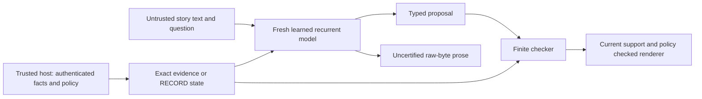
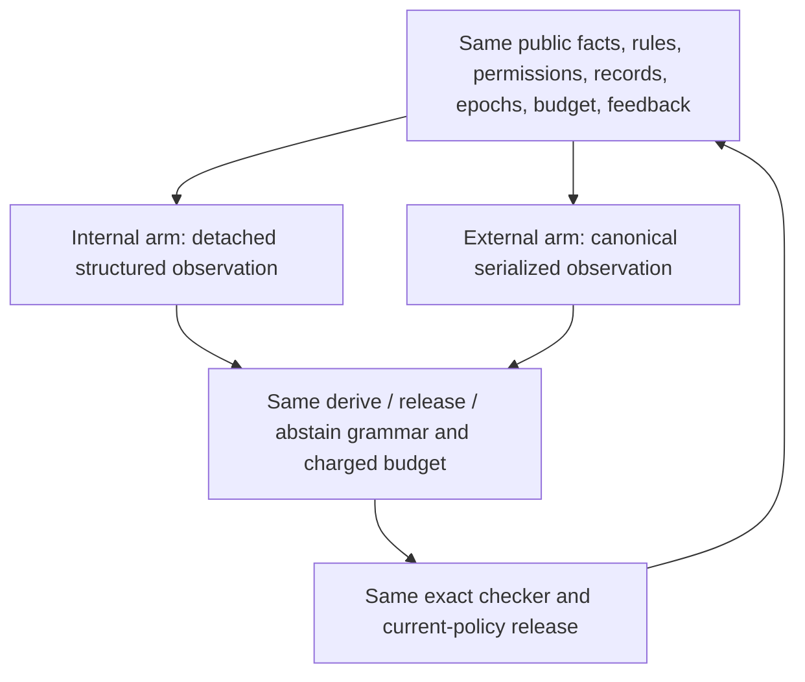

# Architecture and trust boundaries

The current byte model embeds bytes, applies one to four recurrent/SwiGLU
layers, and produces raw-byte logits plus optional typed-claim proposals. An
application-owned event lane builds exact finite evidence state; ordinary story
text never authenticates an event. Internal routing injects an evidence
projection before recurrent layers; output-only routing supplies it after the
last recurrence. A shared bias-free projection matches active projection
parameter counts for the two routes, but repeated internal use still changes
computation and gradients. Raw language outputs remain uncertified.

The parameter-free RMS variant normalizes each FFN input and the shared input
to both final heads. Its stable scaled arithmetic is tested numerically; it is
not an IEEE proof or a full-stack contraction theorem. It reuses architecture
code, never learned weights. The frozen wrapper binds the original trainer,
model and objective-source bytes by SHA-256.

The newer RECORD kernel represents explicit claims and support graphs rather
than learned activation coordinates. It admits facts only through the trusted
host channel. Learned code may propose a declared rule and existing typed
premise records; the checker supplies and validates the conclusion. Records
are evidence-rooted DAGs. First accepted consistent values win until a host
revision; conflicting insertions reject atomically. Every host evidence update
increments a global evidence epoch and discards all derived records; policy
changes invalidate prior release certificates. This deliberately conservative
rule prevents stale transitive support from surviving replacement/revocation.
It does not establish satisfiability or real-world truth of host declarations.

This diagram states the intended contract/dataflow, not completed integration
of RECORD into the model. The implemented model currently uses its older finite
key/value evidence lane. The new RECORD kernel and comparison adapter are
standalone interface plumbing; model integration is prospective.

Both arms see intermediate records and failure feedback after every attempt.
Session nonces/certificates are omitted symmetrically: current records and
epochs supply their semantic content, while the host reconstructs a session-bound
certificate only for release. Same logical information does not imply equal
bandwidth, context use, encoding effort or total compute. An encoding-matched
control and full cost accounting are required before attributing any future
advantage to semantic integration.

The older Lean workflow kernel models three completion bits, grants, attempt
budget and possible worlds. Its theorems require the actual world to belong to
the prior and observations to satisfy the stated truthful-or-contradictory
condition. False but consistent observations can delete the true world. Its
proofs do not transfer to RECORD, model code, natural-language understanding or
real external tools. Python refinement and authenticated deployment remain
unproved boundaries. The RECORD release policy limits its renderer; snapshots
are public to both arms, so no confidentiality claim is made.
